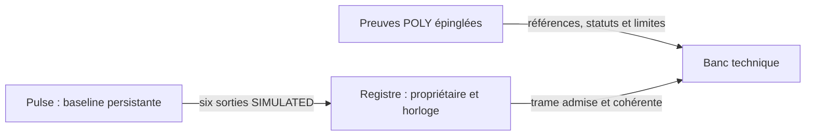

# Banc technique d'organisme : une façade, trois composants

`tools/organisme_entier/organism_workbench.py` compose le noyau documentaire neurobiologique, la baseline Pulse persistante et le registre d'observations. Le même run peut consulter une relation avec sa provenance et suivre les six sorties physiologiques agrégées. Il ne convertit aucune relation du canon en activité nerveuse ou commande physiologique.



Le graphe n'annonce aucun lien causal de C vers P. Le cerveau détaillé reste une couche de références, le modèle physiologique est agrégé, les coordonnées anatomiques et boucles neuronales externes ne sont pas raccordées. Ce jalon n'est pas un organisme entier scientifiquement validé ou un moteur de marche.

## Utiliser le banc

Dans une racine neuve sous le runtime local :

```text
python tools/organisme_entier/organism_workbench.py --runtime-root ../p2 --output-root NEW_BODY_ROOT --tick 1500 --c13 PATH_TO_ORIGINAL_C13
python tools/organisme_entier/organism_workbench.py --runtime-root ../p2 --output-root NEW_BODY_ROOT --read-closed
```

La première commande restaure l'ancre qualifiée, consulte quelques références et avance sur les cinq horizons existants avant fermeture. La seconde relit les preuves sans processus natif. Aucun C13 de remplacement n'est sélectionné ; son chemin est explicite. Si C13 est absent, les deux sources Git restent consultables mais C13 n'est pas déclaré vérifié ou vide.

API : `start()`, `reference(kind,id,group_id=...)`, `snapshot()`, `refresh(command_id)`, `advance_to_known_horizon(command_id,horizon)`, `close()` et `abort()`. Le contexte `with OrganismWorkbench(...) as body:` assure fermeture ou abandon de l'enfant possédé.

`snapshot()` distingue état du banc, dernière trame admise, dernier horizon natif vérifié, statuts des sources et historique des références consultées. Les champs neural_dynamic_simulation, anatomical_registration, canonical_dynamic_bridge, biological_events_applied et observed_state_is_restorable restent false. Il n'y a pas de reconstruction de temps C13, de conversion entre espèces ou de nouvelle boucle autonome.

## Atomicité et échecs

Les sources de références et le profil physiologique sont vérifiés avant création de la racine et du processus. Une racine existante n'est jamais adoptée. Les commandes sont sérialisées dans la façade ; le moteur et le registre conservent leurs propres protections. Une répétition historique retrouve son reçu sans rembobiner la trame récente.

Un refus sain de port/clé/horizon préserve le run actif. Un échec natif ou un refus d'admission après avancement rend ce banc terminal : l'enfant possédé est récolté, la dernière trame admise est conservée et l'observation native non admise ne devient pas un faux état partagé. Cela n'est pas un rollback du moteur. Une admission initiale échouée peut produire une trame absente, jamais six zéros.

La fermeture vérifie le reçu natif, reconstruit toutes les admissions depuis les enveloppes natives, compare exactement le registre final et publie ensuite son reçu de fermeture. Une commande native faite en dehors du coordinateur empêche une fermeture annoncée réussie. Le même contrôle est refait à la relecture : pas seulement les dernières valeurs, mais propriétaires, horloges, nombre de trames et provenance. L'enfant natif n'est jamais relancé par l'export.

Après mort réelle du parent, les fichiers ACTIVE sont des traces périmées ; l'absence de fermeture empêche l'export comme run réussi. Le worker finit son calcul borné et sort sur EOF. Aucune reprise implicite, adoption d'orphelin ou terminaison par PID récupéré.

## Qualification

Quatre ancres réelles, cinq horizons par ancre, six ports admis, 180 comparaisons natives aux références déjà épinglées. Les lectures de références (relation, intervalle global, registre stable avec NaN marqué et C13 souris) ne font pas progresser le moteur et ne changent pas le registre. Cinq cas négatifs réels : mauvais C13 avant lancement, racine étrangère, timeout natif, refus injecté du coordinateur après un véritable avancement et mort réelle du parent. Quatorze tests spécifiques. [Rapport](PHASE2_BANC_ORGANISME_RESULTATS.json).

Les matrices recouvrent celles des composants et ne sont pas additionnées comme validation biologique. Aucun scénario A/B/C, événement biologique, médicament, anesthésie, convergence physiologique, phase 3–5, déploiement, modification main ou fusion de PR #1. L'échec original reste conservé au seuil initial.

Durcissement ultérieur : [audit transversal](PHASE2_AUDIT_INTERFACES.md). La fermeture v0.2 lie aussi le snapshot final ; les archives v0.1 conservent explicitement leur garantie plus faible. Les pertes de manifestes et les deux frontières réelles de publication sont maintenant qualifiées dans la façade, sans modifier le profil natif historique.
