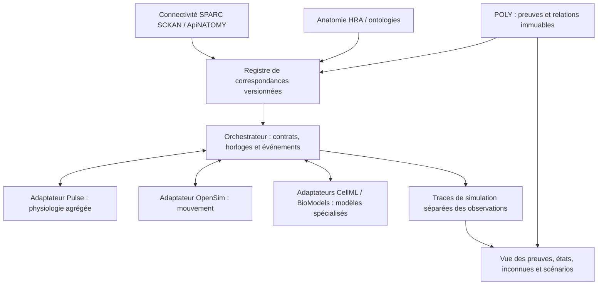

# POLY — plan directeur vivant : organisme entier

État au 18 octobre : **reprise technique continue autorisée pour quatre heures, jusqu’à 14 h 36 Paris / 12 h 36 UTC**. Le bilan nocturne reste historique ; scénarios A/B/C et phases 3–5 toujours exclus. [Baseline persistante](PHASE2_BASELINE_VIVANTE.md), [façade et registre](PHASE2_BANC_ORGANISME.md), [composition réelle](COMPOSITION_TECHNIQUE.json), [preuves portables](PHASE2_PREUVES_PORTABLES.md) et [consultation locale](PHASE2_CONSULTATION_LOCALE.md) sont qualifiés dans leur périmètre borné. [Audit transversal et fermeture v0.2](PHASE2_AUDIT_INTERFACES.md) : garanties et limites historiques distinguées.

Version 0.1 — 2026-10-17 — proposition d'architecture, hors canon scientifique.

## Consulter et reprendre

Point d'entrée permanent : ce document, [état machine](ETAT.json), [journal](JOURNAL.md), [inventaire](INVENTAIRE.json), [contrat](CONTRAT_ADAPTATEUR.md), [scénarios](SCENARIOS.json), [sources et licences](SOURCES_EXTERNES.md).

Point d’entrée opérationnel actuel : [guide technique](REPRISE_TECHNIQUE.md), [capacités/méthodes vérifiables](API_TECHNIQUE.json). Les paragraphes ci-dessous retracent les étapes successives ; leurs résultats négatifs ne sont pas effacés par les qualifications ultérieures.

Lot de phase 1 : [revue des interfaces](REVUE_PHASE1.md), [ports Pulse candidats](PULSE_ADAPTER_CANDIDAT.json), [qualification C13](C13_QUALIFICATION.json), [artefacts épinglés](ARTEFACTS_EXTERNES.json), [mappings candidats](MAPPINGS_CANDIDATS.json).

Sortie documentaire de phase 1 : [références et préparation Pulse](QUALIFICATION_REFERENCE_ET_BUILD.md), [anatomie/connectivité résolues](ANATOMIE_CONNECTIVITE_QUALIFIEE.json), [releases appariées](CONNECTIVITE_RELEASE.json), [patient/build candidat](PULSE_PATIENT_BUILD_CANDIDAT.json), [correspondance de classe anatomique](REFERENCE_CROSSWALK.json).

Première exécution de phase 2 : [build et initialisation](PHASE2_BUILD_ET_INITIALISATION.md), [résultat historique](PHASE2_RESULTATS.json), [reçu de construction](PHASE2_BUILD_RECEIPT.json). Initialisation acquise ; continuité du moteur original au seuil strict conservée en échec. [Diagnostic des états](PHASE2_DIAGNOSTIC_ETAT.md) : deux variables O2 absentes de la sérialisation, chronologie O2→chémorécepteurs→HR observée.

Lire plan/état/journal au début de chaque session et après tout changement d’interface ou de source. Mettre à jour ETAT et JOURNAL dans le même commit ; examiner le backlog une fois par semaine lorsqu’un chantier est actif. Le relais nocturne demandé le 17 octobre avait une échéance au 18 octobre à 08:00 Europe/Paris (06:00 UTC) ; il est désormais en pause. La prolongation diurne explicite et sa nouvelle échéance sont indiquées en tête et dans ETAT ; aucune prolongation implicite. Les jalons restent conditionnés par leurs critères de sortie.

Résultat expérimental ultérieur : [correction O2](PHASE2_CORRECTION_O2.md), [profil épinglé](PULSE_O2_PROFIL_EXPERIMENTAL.json). 360 comparaisons de continuité réussies après correction isolée ; essai original conservé en échec. Intégration technique qualifiée ensuite dans l’ensemble fermé des quatre ancres/cinq horizons ; rollback général toujours indisponible.

[Enveloppes de checkpoint](PHASE2_CHECKPOINT.md) : quatre reprises en processus séparés qualifiées, 180 comparaisons au seuil original, attentes persistées pour un ensemble fermé de sauvegardes. Cycle complet de l’adaptateur et rollback général encore non annoncés.

[Répartiteur de restauration fermé](PHASE2_DISPATCHER.md) : attentes persistées vérifiées, 180 comparaisons natives et commande directe qualifiées ; conservation du dernier succès sur échecs et timeout testée. Reprise et idempotence sont qualifiées dans le périmètre fermé documenté ; [audit des capacités](PHASE2_CONFORMITE_CAPACITES.md).

[Journal d’opérations](PHASE2_OPERATIONS.md) : répétition sans nouvelle exécution, conflit d’identifiant refusé et reprise aux frontières avant lancement/après validation/après engagement. Les qualifications ultérieures de [coordination](PHASE2_COORDINATION.md) et [transactions v2](PHASE2_DLL_V2_RECOVERY.md) précisent leurs garanties ; une issue inconnue reste refusée, sans adoption arbitraire d’enfant.

## Décision et frontières

POLY actuel reste le noyau neurobiologique et documentaire : unités expérimentales, preuves, inconnues, contradictions et limites. Autour de lui, une couche de correspondances et une orchestration pourront relier des modèles ouverts. Aucun modèle externe ne devient une preuve sur les objets POLY par simple raccord.

Le corps de référence sera une composition de modules à résolution déclarée ; il ne prétendra pas représenter chaque cellule, nerf ou organe avec la même précision. Chaque zone non couverte restera visible comme inconnue. Un modèle de marche ou un patient agrégé ne constitue pas un connectome humain individuel.

Périmètre initial : phases 0/1 (inventaire et contrat). Après leur sortie, l'utilisateur a demandé de continuer vers le jalon explicitement annoncé P2-01 : build Pulse isolé, données nécessaires, initialisation du patient, baseline et reprise d'état moteur. Ce lot technique de phase 2 est désormais autorisé. Pas de migration du canon, déploiement, changement de main ou fusion de PR #1 ; phases 3 à 5 non démarrées.

## État réel observé

- Base de cette branche : `main` à `0b879a9347eda9201ea16b7069b3a43f458c311e`. Le README désigne l'atlas v1.2 comme référence documentaire stable et les recherches comme hors canon.
- PR #1 : brouillon ouvert, branche `travail/architecture-experimentale-2026-09-25`, commit `5831527403a27bf781915cc9a6d3d616ccb778fb`. Lecture seule, sans fusion, cherry-pick ni copie de son corpus.
- Modèle de relations v0.2 sur cette branche : 86 unités, 74 MEASURED, 8 RECONSTRUCTED, 4 ND ; 12 chaînes C01–C12 ; 59 séquences reconstruites, 15 décompositions, 39 observations temporelles. Ces chiffres sont recalculés dans INVENTAIRE.
- C13 local : artefact `poly_humain_integration_2026-10-17/payload/assets/c13-suite/C13.json`, distinct du modèle à 86 relations. L'inventaire épingle son SHA-256 et ses objets ; aucune équivalence entre ses nœuds/liens et les 86 relations n'est déduite.
- Qualification C13 existante : 84 objets catégorie A, 32 B, 56 C ; les 80 nœuds signalent l'absence de biologicalTime, datasetId, experimentId et participantSetId. Aucun objet n'a scientific_validation=true. Ces catégories concernent la consultation documentaire et ne sont pas des grades de preuve.
- Aucun clone local de `joanvignes-sudo/POLY` trouvé dans les dépôts inspectés sous Documents ; les clones POLY existants concernaient POLY-viewer. Le workspace de ce chantier est donc un nouveau clone sous `work/POLY`. Les anciens workspaces sont lus seulement. Aucun AGENTS.md dans la base GitHub ni dans les ascendants applicables ; le fichier d'un autre workspace du 14 octobre a été lu et n'est pas un ascendant de celui-ci.

## Architecture cible

| Couche | Responsabilité | Exclusions et interface minimale |
| --- | --- | --- |
| Noyau POLY | Relation expérimentale, source, statut, espèce, préparation, temps et limites | Lecture seule ; identifiant qualifié par version + pointeur JSON |
| Identité et anatomie | Systèmes, organes, tissus, cellules ; part_of et localisation | HRA/UBERON et autres identifiants natifs ; pas de fusion par nom ; cadre, axes, unités, latéralité et transformation explicites |
| Connectivité | Trajets, populations, afférences/efférences, territoires | SCKAN/ApiNATOMY ; espèce et assertion d'origine ; présence de trajet ≠ délai ou activation |
| Physiologie | États agrégés cardiovasculaires, respiratoires, thermiques, métaboliques | Pulse isolé, version et patient épinglés ; limites du modèle nerveux à examiner ; ports exposés seulement s'ils existent réellement |
| Mouvement | Articulations, muscles, cinématique/dynamique | OpenSim ; modèle individuel, forces et unités ; coût métabolique à justifier, pas déduit de l'animation |
| Modèles spécialisés | Canaux, synapses, endocrinologie, PK/PD selon besoin | CellML/BioModels ; équations, paramètres, domaine et solveur épinglés ; aucun couplage implicite |
| Orchestration | Propriétaire de chaque variable, ordre des échanges et bilan | Adaptateurs séparés ; ports négociés, erreurs explicites et traces rejouables |
| Présentation | Montrer ce qui est sollicité, simulé, observé ou inconnu | Horloge visuelle indépendante ; aucune animation convertie en preuve causale |

## Provenance et identifiants

Conserver les identifiants historiques sans les renuméroter. Leur identité complète est `(namespace, artifact_version_or_digest, native_id, json_pointer)` ; E01 ou S15 seuls ne sont pas globaux. Un pointeur vers la branche expérimentale doit inclure son commit exact, jamais seulement son nom mutable. Les identifiants locaux C13 incluent le groupe et le hash de l'artefact.

Chaque assertion nouvelle porte : source primaire/DOI ou URI, version, empreinte si octets disponibles, date de consultation, pointeur d'extraction, espèce/préparation/cohorte, méthode, rôle de la source, limites et responsable de revue. Le statut original est conservé textuellement ; un champ séparé décrit observation, simulation, hypothèse ou repère pédagogique. Ne pas transformer OBSERVATION de C13 en MEASURED par défaut.

Les mappings portent `exactMatch`, `closeMatch`, `partOf`, `locatedIn` ou `candidate`, leur justification et une revue. Une identité de libellé n'autorise jamais exactMatch. Les contradictions restent des assertions coexistantes. Une preuve réutilisée par deux publications n'est pas comptée deux fois. Référence d'atlas, région illustrative et position mesurée sont trois types différents. Les xyz pédagogiques de C13 et layout3d de v0.2 ne sont pas des coordonnées biologiques.

Étendre la provenance existante (PROVENANCE.csv et SOURCES_MAITRE), sans la remplacer. Aucun changement automatique de niveau de preuve : la revue scientifique prévue dans le pipeline existant demeure nécessaire avant intégration au corpus.

## États, événements, transitions et continuité

- **EntityRef** : objet natif versionné ; espèce, échelle, compartiment et provenance.
- **StateVariable** : quantité, valeur ou ND, unité, propriétaire, horloge, intervalle de validité, incertitude, méthode d'obtention. ND n'est ni zéro ni une constante à interpoler.
- **Event** : identifiant unique, cause, cible, horloge, temps, charge utile avec unités, politique d'application et de déduplication. Un médicament précise substance, voie et dose ; un bruit intensité/durée et référentiel acoustique ; une brûlure localisation, étendue et paramètres effectivement acceptés par le modèle choisi.
- **Transition** : préconditions, ports lus/écrits, modèle/règle et version, délai ou ND, événement déclencheur, sorties et empreinte du contexte. Une transition simulée n'est pas une relation empirique.
- **RunManifest** : patient/modèle, état initial, versions, paramètres, seed si nécessaire, événements ordonnés, solveurs, pas/tolérances, mappings acceptés, licences, traces et erreurs.

Chaque variable dynamique a un seul auteur par run. Les boucles rapides sont résolues à l'intérieur du module propriétaire ; les échanges entre modules passent par des points de synchronisation. Aucun double baroréflexe, aucune deuxième consommation d'ATP ou masse déjà comptée par Pulse. Un échec d'adaptateur arrête le segment concerné et marque les sorties invalides ; pas de maintien silencieux comme nouvelle mesure.

## Multi-échelle et multi-horloges

Échelles : molécule → cellule → population → tissu → organe → organisme → environnement, reliées par opérations explicites d'agrégation/désagrégation avec unités, effectifs, hypothèses et incertitudes. Ne pas distribuer une moyenne d'organe à des neurones fictifs. Raffinement à la demande uniquement si la question et les données le justifient.

Horloges expérimentales conservées séparément : origine, unité, précision, intervalle, préparation et alignement connu. Une horloge de simulation sert au rendez-vous des solveurs ; elle ne rend pas les expériences synchrones. L'horloge de lecture accélérée appartient à la vue. Toute conversion inter-horloges exige une transformation documentée et une erreur ; absence d'alignement = calcul bloqué. Impossible d'additionner des délais issus de préparations différentes pour inventer une latence du corps entier.

Pour la future co-simulation : définir pas locaux selon les modèles, pas d'échange, maintien/interpolation autorisés par variable, conservation masse/énergie et tolérances, ordre stable des événements simultanés `(temps, priorité, id)`, rejet des événements tardifs et politique de rollback. Mesurer convergence en réduisant les pas d'échange avant d'interpréter un résultat. Aucune valeur numérique de pas n'est fixée sans moteur/version et essai de convergence.

## Migration C01–C13 / 86 relations

1. Phase 0 : épingler les sources et produire l'index par objet, statut et pointeur ; garder les branches documentaires distinctes. L'inventaire inclut les 86 relations et 74 connecteurs de v0.2 ainsi que les objets C13 locaux, sans recopier mesures et traces.
2. Phase 1 : enveloppe externe en lecture seule, statut original, pointeur, provenance et avertissements ; ports non résolus = `UNMAPPED`. Les anciennes pages et fichiers restent utilisables.
3. Plus tard, table de raccord revue relation par relation : entrées/sorties, quantités/unité, espèce, compartiment, identité expérimentale et horloge. Conserver les 4 parents ND et les 8 reconstruits ; ne pas activer les 59 séquences ou 15 décompositions comme mécanismes mesurés.
4. C13 : qualification groupe/étude puis nœud/lien, participants et horloges réelles ; ne pas raccorder humain et souris comme un sujet unique. Les 86 relations ne sont pas le total C01–C13.
5. Comparaison en mode parallèle : zéro perte d'identifiant, source, limite, ND, contradiction et statut ; rapport de différences avant toute migration. Migration réversible par overlay et manifeste ; jamais réécriture des originaux.

## Scénarios de validation futurs

Les fiches machine [SCENARIOS.json](SCENARIOS.json) précisent préconditions, assertions et erreurs attendues. Ils sont **spécifiés, non exécutés biologiquement**.

| Test | Question et couplage envisagé | Critères de réussite et limites |
| --- | --- | --- |
| A : repos → exercice | Patient Pulse stabilisé, événement exercice ; OpenSim ultérieur si nécessaire au mouvement | Run rejouable, événement appliqué une seule fois, paramètres explicites, états/unité et provenance complets, bilans et convergence dans tolérances pré-déclarées ; évolution HR/ventilation comparée à référence du modèle, sans inventer une mesure humaine |
| B : brûlure | État de référence, action compatible avec la version Pulse sélectionnée | Vérifier capacité et champs réels de l'action avant implémentation ; trajectoires thermiques/hémodynamiques/volume, bilans et limites du domaine ; atteinte cutanée ≠ douleur subjective ni simulation détaillée de tous les nocicepteurs |
| C : marche → bruit soudain | Mouvement OpenSim + événement sensoriel ; couche POLY des preuves et lacunes | Continuité des horloges de simulation, événement ponctuel, frontière explicite entre trajet anatomique et activation ; si liaison auditive/posturale non prouvée : ND et arrêt du raccord, jamais chaîne de sursaut inventée |

Autres scénarios au backlog : course, médicament et anesthésie. Choisir substance, voie, dose et domaine uniquement après sélection/qualification du modèle. Un dispositif d'anesthésie disponible ne garantit pas la validité de tout agent ou effet neuronal.

## Jalons et backlog priorisé

| ID / priorité | Phase / dépendance | Livrable et sortie vérifiable | État |
| --- | --- | --- | --- |
| P0-01 / P0 | 0 | Références réelles, AGENTS inspectés, canon/branches distingués | Fait |
| P0-02 / P0 | 0, P0-01 | Inventaire reproductible 86 relations + connecteurs + C13, hashes | Fait pour les artefacts désignés ; pas audit exhaustif de tous les corpus locaux |
| P1-01 / P0 | 1, P0-02 | Contrat v0.1 + exemples synthétiques et rejets sémantiques | Fait, proposition à réviser |
| P1-02 / P0 | 1, P1-01 | Revue des premiers ports Pulse : capacités exactes et variables propriétaires | Fait comme candidat statique ; moteur non exécuté |
| P1-03 / P0 | 1 | Qualifier C13 : temps/datasets/participants manquants ; correspondances C01–C12 | Audit documentaire fait ; identités et horloges natives encore manquantes, aucune équivalence exacte introduite |
| P1-04 / P1 | 1 | Épingler versions et licences des références minimales sélectionnées ; premier mapping anatomique candidat | Fait dans ce périmètre : HRA de production, paire ApiNATOMY/SCKAN, référence cardiaque résolue et recette Pulse ; construction et validation dynamique non exécutées |
| P2-01 / P1 | 2, continuation explicitement demandée après sortie de phase 1 | Build/données Pulse, initialisation, baseline, reprise ; puis test A et convergence | Partiel : moteur original en échec conservé ; correction isolée 360/360, reprises séparées puis répartiteur fermé qualifiés (180 comparaisons chacun). Idempotence, enfant, exclusion, transaction aux frontières nommées et refus CLI qualifiés dans le périmètre fermé ; inventaire imports/licences réalisé ; profil explicite DLL v2 qualifié ; entrée historique v1 inchangée ; cycle général, A et convergence non lancés |
| P3-01 / P1 | 3, P2-01 | Anatomie HRA + trajet SCKAN/ApiNATOMY minimal revu | Non démarré |
| P3-02 / P1 | 3, P2-01 | Test B, domaine brûlure et conservation | Non démarré |
| P4-01 / P2 | 4, P3-01 | OpenSim et test C ; raccords non démontrés explicitement bloqués | Non démarré |
| P5-01 / P2 | 5 | Un modèle CellML/BioModels sélectionné pour un manque précis | Non démarré |
| P5-02 / P2 | 5 | Médicament/anesthésie, reproductibilité et validation ciblée | Non démarré |

Responsabilité de réalisation : mainteneur du chantier ; validation scientifique et choix d'artefacts : revue humaine à attribuer, sans prétendre qu'elle a déjà eu lieu. Un jalon se ferme avec fichier, résultat de contrôle et limite connue ; un blocage nomme l'élément manquant.

## Critères transversaux de succès

Zéro modification du canon et de main ; PR #1 intacte. Couverture d'inventaire exacte des artefacts épinglés, unicité des clés qualifiées et zéro référence pendante. Toutes les sorties simulées sont étiquetées SIMULATED ; aucune promotion de preuve. Conversion d'unités et horloges contrôlée, ND préservés, replay déterministe à tolérance documentée, échec explicite sur port absent, licence inconnue, espèce incompatible ou double écriture. Les tests A/B/C futurs ont leurs seuils chiffrés pré-déclarés selon le modèle et les références avant exécution. Vérification du logiciel, validation d'un modèle et preuve expérimentale sont trois conclusions séparées.

## Risques et décisions ouvertes

| Risque | Réponse / condition de sortie |
| --- | --- |
| Confondre simulation et canon ou conscience | Couches séparées, statut original, provenance visible ; aucune conclusion sur la conscience |
| Identité fictive inter-études/espèces | Clés qualifiées, mappings candidats, revue et ports bloqués |
| Faux temps causal / interpolation ND | Horloges natives ; alignement documenté requis ; tests de rejet |
| Recouvrement et instabilité numérique | Propriété unique, conservation, test de convergence, rollback explicitement spécifié |
| Précision anatomique trompeuse | Cadres et transformations ; schéma illustratif jamais présenté comme localisation mesurée |
| Dépendances lourdes ou API mouvantes | Adaptateurs isolés, versions épinglées, capacités déclarées, mode absent explicite |
| Licences hétérogènes | Séparer code, modèles, données, images ; NOTICE et attribution par artefact avant import ; voir SOURCES_EXTERNES |
| Surpromesse corps entier | Carte de couverture et inconnues ; un module minimal utile par jalon |

Décisions de phase 1 : Pulse 4.4.0 épinglé, interface C++, intensité d'exercice et six sorties, propriété de la physiologie agrégée à Pulse. Les références HRA et ApiNATOMY/SCKAN demeurent documentaires ; les modèles spécialisés et musculaires restent non sélectionnés. En phase 2, le build/données et le patient synthétique ont été exécutés avec un correctif d'horodatage de portabilité déclaré, sans modifier les équations. Deux états O2 omis du schéma et du sérialiseur ont été identifiés, avec divergence O2/chémorécepteurs avant HR. Leur correction isolée et le rejet des anciens checkpoints ont été qualifiés ; les enveloppes et le répartiteur fermé passent leurs matrices. Les identifiants et frontières d’interruption passent ; la durée de vie de l’enfant natif passe les interruptions avant entrée et pendant calcul ; l’exclusion exécution/récupération passe sur cet hôte ; la récupération avant mutation passe ; la transaction publiée passe les interruptions aux frontières nommées ; reste l’audit de conformité/refus avant toute extension du cycle de l’adaptateur, puis préparer A et la convergence ; repères, alignements C13 et comparaison SCKAN compilée restent ouverts. Installation confinée au workspace, aucun déploiement.

Qualification de la durée de vie native : [garanties et limites](PHASE2_CHILD.md), [résultats](PHASE2_CHILD_RESULTATS.json). L’exclusion entre clients coopérants est qualifiée ; récupérateur périmé avant mutation qualifié ; transaction publiée qualifiée aux frontières nommées ; audit conformité/refus réalisé ; inventaire imports/licences réalisé ; profil explicite DLL v2 qualifié ; 24 cas de reprise/transactions v2 qualifiés ; timeout natif qualifié ; périmètre technique autorisé achevé, décision requise avant la suite.

Coordination : [garanties et limites](PHASE2_COORDINATION.md), [résultats](PHASE2_COORDINATION_RESULTATS.json).

Récupération périmée avant mutation : [garanties](PHASE2_STALE_RECOVERY.md), [résultats](PHASE2_STALE_RECOVERY_RESULTATS.json).

Préparation de transaction : [contrat et limites](PHASE2_RECOVERY_TRANSACTION.md), [état structuré](PHASE2_RECOVERY_TRANSACTION.json). Préparateur/inspecteur et persistance explicite du plan dans le guard qualifiés ; exécuteur explicite qualifié aux frontières nommées de mort de processus.

Persistance explicite de transaction : [commandes et limites](PHASE2_TRANSACTION_PREPARE.md), [résultats](PHASE2_TRANSACTION_PREPARE_RESULTATS.json).

Reprise de transaction : [commandes et limites](PHASE2_TRANSACTION_RESUME.md), [résultats](PHASE2_TRANSACTION_RESUME_RESULTATS.json).

Audit des capacités et refus CLI : [lecture et limites](PHASE2_CONFORMITE_CAPACITES.md), [matrice structurée](PHASE2_CONFORMITE_CAPACITES.json), [refus](PHASE2_TRANSACTION_REFUSAL_RESULTATS.json).

Inventaire runtime/licences (textes tiers conservés octet par octet) : [preuves et limites](PHASE2_RUNTIME_AUDIT.md), [résultats](PHASE2_RUNTIME_AUDIT_RESULTATS.json), [manifest DLL candidat non appliqué](PHASE2_DLL_CANDIDATE_MANIFEST.json).

Profil DLL explicite v2 : [commande et limites](PHASE2_DLL_V2.md), [résultats](PHASE2_DLL_V2_RESULTATS.json), [bindings séparés](PHASE2_CHECKPOINT_BINDINGS_DLL_V2.json). L’entrée v1 historique reste non liée aux DLL ; aucun changement implicite de ses reçus.

Récupération DLL v2 : [24 cas et limites](PHASE2_DLL_V2_RECOVERY.md), [résultats structurés](PHASE2_DLL_V2_RECOVERY_RESULTATS.json).

Sortie du lot technique autorisé : [synthèse et reprise](BILAN_TECHNIQUE_P2_01.md). P2-01 global demeure partiel avant A/convergence ; aucun scénario ni phase supplémentaire engagé. [Timeouts v2](PHASE2_DLL_V2_TIMEOUT_RESULTATS.json).

## Reprise technique du 18 octobre après l’échéance nocturne

Prolongation explicite de quatre heures après échange utilisateur ; aucune reprise du relais nocturne périmé. Enchaîner les lots utiles dans la même session avec contrôles proportionnés, sans rendre la main après chaque sous-lot. Sortie d’un lot = point de sauvegarde, pas clôture automatique de l’autonomie.

- P2-01-T1 : lecture engagée vers enveloppes POLY, six sorties, provenance/horloges et refus — qualifié ([preuves](PHASE2_SORTIES_POLY_RESULTATS.json)).
- P2-01-T2 : session technique liée au manifeste, restauration fermée, lecture et fermeture — [huit cas réels qualifiés](PHASE2_SESSION.md).
- P2-01-T3 : worker persistant séparé, même baseline fermée et mêmes cinq horizons, lectures/avancements bornés sans événement — [qualifié](PHASE2_BASELINE_VIVANTE_RESULTATS.json).
- P2-01-T4 : registre technique de propriété, identité des horloges et admission atomique des observations ; pas de couplage physiologique — [qualifié](PHASE2_REGISTRE_OBSERVATIONS.md).
- P2-01-T5 : résolution en lecture seule du canon épinglé et de ses références, statuts conservés et propagation numérique bloquée — [670 références qualifiées](PHASE2_REFERENCES_CANON.md).
- P2-01-T6 : façade technique d’organisme composant preuves, baseline vivante et registre, sans raccord causal/événement — [qualifiée](PHASE2_BANC_ORGANISME.md).
- P2-01-T7 : manifeste de composition/couverture réel et inspection des preuves d’un run fermé — [quatre paquets portables qualifiés](PHASE2_PREUVES_PORTABLES.md).
- P2-01-T8 : consultation locale en lecture seule des instants enregistrés et de la provenance — [120 valeurs, trois refus et affichage mobile qualifiés](PHASE2_CONSULTATION_LOCALE.md), sans publication ni nouvelle simulation.
- P2-01-T9 : audit transversal de reprise et cohérence des garanties — [défauts reproduits et corrigés dans la façade](PHASE2_AUDIT_INTERFACES.md), fermetures v0.2 et deux frontières réelles qualifiées ; contrôleur natif historique conservé avec sa limite d’E/S hors contexte explicitée.
- P2-01-T10 : [46 liaisons API sur neuf composants](API_TECHNIQUE.json) contrôlées statiquement et [guide de reprise](REPRISE_TECHNIQUE.md) vérifié ; candidats, méthodes bornées et refus séparés, notes historiques réconciliées sans effacer les échecs.
- P2-01-T11 : [garde native distincte](PHASE2_GARDE_NATIVE.md) qualifiée : 180 comparaisons + 180 lectures identiques, six échecs réels et trois refus ; contrôleur/profil numériques préservés.
- P2-01-T12 : [composition explicite garde → façade → registre → portable](PHASE2_COMPOSITION_GARDEE.md) qualifiée : quatre trajectoires, 180 comparaisons, trois échecs réels/trois refus et anciens lecteurs conservés. --guarded est un choix explicite, pas un repli ou un changement silencieux du défaut.
- P2-01-T13 : [consultation locale gardée](PHASE2_CONSULTATION_GARDEE.md) qualifiée : quatre preuves, profils/garanties visibles, 120 valeurs exactes, refus et affichage mobile ; aucun moteur/publication.
- P2-01-T14 : audit du périmètre Git, des sources épinglées et de la livraison, avec point de reprise et vérificateur consultable ; correction uniquement de défauts démontrés dans le périmètre technique.

Le cycle dynamique général et les scénarios restent des jalons distincts ; les méthodes bornées seront nommées comme telles.

Les profils live et leur qualification conservent leurs octets épinglés ; règles Git ciblées -text et cr-at-eol pour distinguer CRLF de véritables espaces de fin de ligne. Les SHA ne sont pas modifiés pour satisfaire un contrôle de forme.
